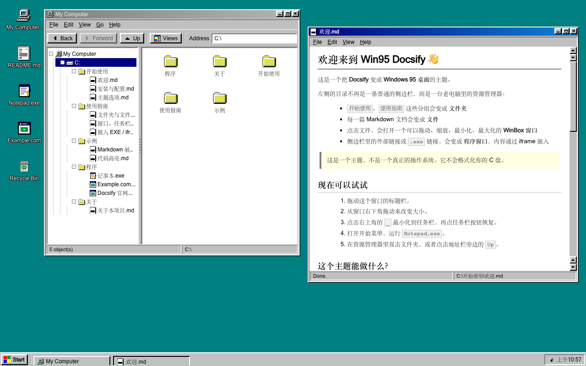
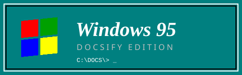

# Win95 Docsify



把 [Docsify](https://docsify.js.org) 文档站变成一个 **Windows 95 桌面**。

- 侧边栏分组 → 文件夹
- 每篇 Markdown → 文件
- 点击文件 → 可拖动 / 缩放 / 最小化 / 最大化的 WinBox 窗口
- 外部链接、`.html`、`.exe` 链接 → iframe 程序窗口
- 任务栏、开始菜单、桌面图标、Run、关机彩蛋、启动画面



## 快速预览

```bash
cd docsify-win95
python3 -m http.server 8080
# 打开 http://localhost:8080/
```

> 需要通过 HTTP 访问，直接 `file://` 打开会被浏览器的 AJAX 限制拦住。

## 特性

| 功能 | 说明 |
| --- | --- |
| 文件夹树 | 解析 `_sidebar.md` 的嵌套列表，分隔条可左右拖动 |
| 文档窗口 | 每篇文档独立窗口，可同时打开多篇 |
| 程序窗口 | iframe 嵌入网页或本地 HTML 小应用，支持自定义图标 |
| 任务栏 | 窗口按钮、最小化、时钟 |
| 开始菜单 | My Computer、程序、Run、Shut Down、About |
| 桌面图标 | 可配置 |
| 启动画面 | "Starting Windows 95" |
| 关机彩蛋 | 经典 "It's now safe to turn off your computer." |
| 响应式 | 小屏幕自动最大化窗口 |

## 安装

把 `theme/` 复制到你的 Docsify 站点，然后按下面顺序加载：

```html
<link rel="stylesheet" href="theme/vendor/docsify-core.min.css" />
<link rel="stylesheet" href="theme/win95.css" />

<script>
  window.$docsify = {
    loadSidebar: true,
    basePath: 'docs/',
    win95: {
      boot: true,
      drive: 'C:',
      rootName: 'My Computer',
    },
  };
</script>

<script src="theme/vendor/docsify.min.js"></script>
<script src="theme/vendor/winbox.min.js"></script>
<script src="theme/win95.js"></script>
```

`win95.js` 必须在 Docsify 初始化（`DOMContentLoaded`）之前执行。

## 把链接变成程序

侧边栏：

```md
- [记事本](apps/notepad.html)          <!-- .html 自动识别 -->
- [Example](https://example.com)       <!-- 外部链接自动识别 -->
- [我的应用](some/path ':class=w95-exe') <!-- 显式标记 -->
```

正文：

```md
[打开示例网站](https://example.com ':class=w95-exe')
```

配置：

```js
win95: {
  apps: [
    { title: 'Notepad', url: 'docs/apps/notepad.html', width: 620, height: 460 },
    { title: 'Example.com', url: 'https://example.com' },
  ],
}
```

## 自定义程序图标

程序图标会用于资源管理器、窗口标题栏、任务栏、开始菜单和桌面快捷方式。

**侧边栏类名 + `icons` 映射：**

```md
- [记事本](apps/notepad.html ':class=w95-icon-notepad')
- [Jupyter](https://jupyter.org ':class=w95-icon-jupyter')
```

```js
win95: {
  icons: {
    notepad: 'notepad.svg',
    jupyter: './icons/jupyter.png',
  },
}
```

**或者直接在 `apps` 里指定：**

```js
win95: {
  apps: [
    { url: 'https://jupyter.org', icon: './icons/jupyter.png' },
  ],
}
```

图标路径：

- `notepad.svg` → `theme/assets/icons/notepad.svg`
- `./icons/jupyter.png` → 相对于 `index.html`
- `/icons/jupyter.png` → 站点根目录
- `https://...` → 远程图片

## 自定义桌面图标

```js
win95: {
  desktop: [
    { title: 'My Computer', icon: 'computer', action: 'explorer' },
    { title: 'README.md', icon: 'file', action: 'doc', pathKey: '/' },
    {
      title: 'Notepad.exe',
      icon: 'notepad.svg',
      action: 'app',
      url: 'docs/apps/notepad.html',
    },
    { title: 'Recycle Bin', icon: 'recycle', action: 'recycle' },
  ],
}
```

完整的 `action` 列表和桌面图标配置见 [主题选项](docs/guide/options.md)。

## 选项

完整选项见演示站里的 `主题选项` 页面，或直接看 `theme/win95.js` 顶部的 `DEFAULTS`。

常用：

```js
win95: {
  boot: true,                 // 启动画面
  openWelcome: true,          // 自动打开当前文档
  drive: 'C:',
  rootName: 'My Computer',
  externalLinks: 'window',    // 'window' | 'browser'
  docFooter: true,
  clock24: false,
  wallpaper: '',
  icons: { /* 自定义图标映射 */ },
  desktop: [ /* ... */ ],
  apps: [ /* ... */ ],
  startMenu: [ /* ... */ ],
}
```

## 已知限制

- 依赖 Docsify 的 **hash 路由**（默认）。
- 需要 `loadSidebar: true` 才能生成完整目录树。
- 文档窗口通过克隆隐藏的 `#main` 渲染结果实现，因此 `<script>` / Vue 组件不会在窗口里重新初始化。
- iframe 受目标网站的 `X-Frame-Options` / CSP 限制，被拒绝时会空白。
- 浏览器前进/后退不会自动重开窗口。
- Docsify 自带的 `coverpage` / `navbar` / 侧边栏外壳会被隐藏，由 Win95 桌面取代。
- 不是一个真正的操作系统。不会删除你的文件。

## 目录结构

```text
docsify-win95/
├── index.html
├── theme/
│   ├── win95.css
│   ├── win95.js
│   ├── app.css
│   ├── assets/icons/
│   └── vendor/            # docsify + winbox + licenses
├── docs/
│   ├── _sidebar.md
│   ├── README.md
│   ├── guide/
│   ├── examples/
│   └── apps/notepad.html
└── README.md
```

## 致谢

- 视觉参考：[Typecho Win95 主题](https://www.vpsmm.com/)（vpsmm / h01000110）
- 像素图标与滚动条素材：取自上述 Typecho 主题的 `assets/img`
- 窗口管理：[WinBox.js](https://github.com/nextapps-de/winbox)（Apache-2.0）
- 文档框架：[Docsify](https://docsify.js.org)（MIT）

## License

主题代码以 MIT License 发布。第三方库和图标素材遵循各自许可证。
